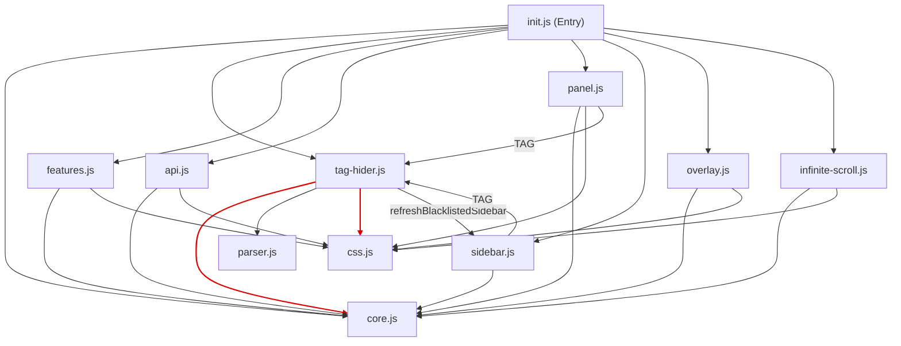

# Architektur & Abhängigkeiten – Rule34 Combined Scripts

> Stand: v5.32 · Quelle der Wahrheit ist `src/` (12 Module, per esbuild zu einer
> Einzeldatei gebaut). Dieses Diagramm dient als Basis, um die Modul-Grenzen beim
> weiteren Splitten zu planen.

## Modulübersicht

| Modul | Importiert von | Exportiert (Auswahl) | Rolle |
|---|---|---|---|
| `core.js` | — (Blatt) | `CONSTANTS`, `DEFAULT_CONFIG`, `CONFIG`, `getRoute`, `getPerPage`, `safeStorageGet/Set`, `readJson`, `observers`, `debounce`, `sleep`, `isTyping`, `gmRequest`, `buildApiUrl`, `AD_SELECTORS`, `AD_MARKERS`, … | Konstanten, Storage, Route-Parsing, Utils, zentrale Observer-Liste |
| `css.js` | — (Blatt) | `TAG_CSS`, `HEADER_CSS`, `PAGE_INDICATOR_CSS`, `BLACKLIST_CSS`, `PANEL_CSS`, `INFINITE_SCROLL_CSS`, `OVERLAY_CSS`, `API_MODAL_CSS` | Reine CSS-Strings |
| `parser.js` | — (Blatt) | `normalizeTag`, `v2ToAst`, `astToText`, `walkTokens`, `parseRulesInput`, `compileRules`, `anyRuleMatches` | Regel-Parser (pur, getestet) |
| `version.js` | — (Blatt) | `VERSION` | Versionsnummer |
| `tag-hider.js` | `core`, `parser`, **`sidebar`**, `css` | `TAG` (IIFE-Objekt) | SmartSkip+/Tag-Hider: Regeln, Cache, Verstecken, Toggle |
| `sidebar.js` | **`tag-hider`**, `core` | `setupSidebarIntegration`, `refreshBlacklistedSidebar` | Blacklisted-Sidebar (Anzeige + Auto-Create) |
| `panel.js` | `tag-hider`, `core`, `css` | `setupControlPanel` | Schwebendes R34-Panel |
| `features.js` | `core`, `css` | `hideBlacklisted`, `removeDuplicateThumbnails`, `removeAnnoyances`, `fixPaginatorLinks`, `removePidParameter`, `setNativeLazyLoading`, `removeThumbTitle`, `hideEmptyThumbSpans`, `cleanupFavoritesArtifacts`, `updateFavicon`, `updatePageIndicator`, `setupFavoriteOnHover`, `setupCollapsibleHeader`, `dedupeContexts`, `markFavoritedThumbs` | DOM-Tweaks/Features |
| `api.js` | `core`, `css` | `handleOptionsPage`, `checkApiKey`, `restoreDeletedPost` | API-Key/Restore |
| `overlay.js` | `core`, `css` | `setupThumbOverlay` | Hover-Overlay |
| `infinite-scroll.js` | `core`, `css` | `setupInfiniteScroll` | Eigener Infinite-Scroll |
| `init.js` | `core`, `tag-hider`, `features`, `api`, `panel`, `sidebar`, `overlay`, `infinite-scroll` | — (Entry) | SPA-Maschine, Mutation-Observer, Orchestrierung |

## Abhängigkeitsgraph



ASCII-Fallback:

```
                    ┌──────────┐
                    │  init.js │  (Entry, orchestriert alles)
                    └────┬─────┘
   ┌──────────┬──────────┼────────────┬──────────┬──────────┬─────────┐
   ▼          ▼          ▼            ▼          ▼          ▼         ▼
tag-hider  features     api          panel     sidebar   overlay  infinite-scroll
   │          │          │            │          │          │         │
   │          └────┬─────┘            │          │          │         │
   │  ┌──────┐     │                  │          │          │         │
   ├─▶│ core │◀────┴──────────────────┴──────────┴──────────┴─────────┘
   │  └──────┘
   │  ┌──────┐
   ├─▶│ css  │◀─────(features/api/panel/overlay/infinite-scroll)
   │  └──────┘
   │  ┌────────┐
   └─▶│ parser │
      └────────┘

   tag-hider ◀──▶ sidebar        ← ZYKLUS (siehe unten)
```

## Zirkuläre Kopplung: `tag-hider.js` ↔ `sidebar.js`

Dies ist der einzige ESM-Import-Zyklus im Projekt (im README bewusst dokumentiert).

```
tag-hider.js ──import refreshBlacklistedSidebar──▶ sidebar.js
sidebar.js   ──import TAG────────────────────────▶ tag-hider.js
```

**Wer ruft wen auf (alles nur zur Laufzeit):**

- `tag-hider.js` → `refreshBlacklistedSidebar()` in
  - `reapply()` (nach Toggle/Regel-Save)
  - `initObservers()` (einmal nach Initial-Scan, Liste & Favoriten)
- `sidebar.js` → `TAG.*` in
  - `refreshBlacklistedSidebar()`: `TAG.getEnabled()`, `TAG.getHiddenCount()`
  - `createBlacklistedSidebar()`: `TAG.toggle()`, `TAG.openRules()`
  - `setupSidebarIntegration()`: `TAG.isRouteLockedOff()`

**Warum das funktioniert (und nicht zusammenbricht):**

1. Beide Module greifen erst **zur Laufzeit** auf die Exports des anderen zu —
   niemals auf Top-Level-Ebene während der Modul-Evaluierung.
2. `TAG` ist ein `const`, der in `tag-hider.js` per IIFE initialisiert wird; die
   IIFE ruft beim Evaluieren nur `GM_addStyle(TAG_CSS)` auf, **nicht** die
   Sidebar-Funktion.
3. ESM liefert **Live-Bindings**: Evaluiert die Engine `tag-hider.js`, wertet sie
   zuerst `sidebar.js` aus (Depth-first). `sidebar.js` referenziert `TAG` nur
   innerhalb von Funktionskörpern und läuft deshalb vollständig durch, obwohl
   `TAG` noch nicht initialisiert ist. Erst danach wird `TAG` gesetzt; spätere
   Aufrufe sehen den fertigen Wert.

## Versteckte Kopplung über das DOM (kein Import)

Zusätzlich zum Import-Zyklus gibt es eine **stille** Kopplung, die ein
Dependency-Graph allein aus `import`-Zeilen nicht zeigt:

- `tag-hider.js` schreibt direkt in das Panel-DOM, das `panel.js` aufgebaut hat:
  `updatePanelState()` liest `document.getElementById('toggleSkip')` und setzt
  dessen Text/Zustand — **ohne** `panel.js` zu importieren.
- `panel.js` importiert umgekehrt `TAG` und ruft `TAG.toggle()`,
  `TAG.openRules()`, `TAG.openCookie()`, `TAG.updatePanelState()` auf.

```
panel.js ──import TAG──▶ tag-hider.js          (Import-Kante, eine Richtung)
tag-hider.js ──schreibt #toggleSkip──▶ panel-DOM  (DOM-Kante, unsichtbar)
```

Diese DOM-Kopplung ist fragiler als ein Import, weil sie von der konkreten
ID `#toggleSkip` abhängt — bricht die ID oder baut `panel.js` das Markup um,
schlägt `updatePanelState()` still fehl.

## Empfohlene Modul-Grenzen beim Splitten

1. **Zyklus auflösen (tag-hider ↔ sidebar):** `setupSidebarIntegration` und
   `refreshBlacklistedSidebar` sollten `TAG` **nicht** selbst importieren,
   sondern eine schmale Schnittstelle als Argument erhalten
   (`setupSidebarIntegration({ getEnabled, getHiddenCount, toggle, openRules, isRouteLockedOff })`),
   die `init.js` aus `TAG` zusammenbaut. Damit zeigt die Kante nur noch
   `init → sidebar` und `init → tag-hider` — azyklisch.
   Alternativ: ein kleines `events.js`/`controller.js`, das beide importieren
   (Mediator), und `TAG`/Sidebar melden Zustandsänderungen über diesen Bus.
2. **Panel-DOM-Kopplung auflösen:** den `#toggleSkip`-Zustand über einen
   Rückruf/Event statt über direkte DOM-Lese-Zugriffe synchronisieren. `TAG`
   sollte den Panel-Zustand nur *melden*, nicht selbst schreiben.
3. **Blatt-Module unangetastet lassen:** `core`, `css`, `parser`, `version`
   haben keine internen Abhängigkeiten und sind bereits saubere Grenzen —
   `parser` ist zudem pur und getestet.
4. **`features.js` ist ein Sammelmodul:** 15 Exports mit unterschiedlicher
   Zuständigkeit (DOM-Cleanup, Paginator, Favicon, Marker, Hover). Beim
   Splitten lohnt sich die Trennung in „Batch-Transformationen“ (laufen pro
   `runAll`-Batch) vs. „einmalige Setups“ (Observer/Listener).
